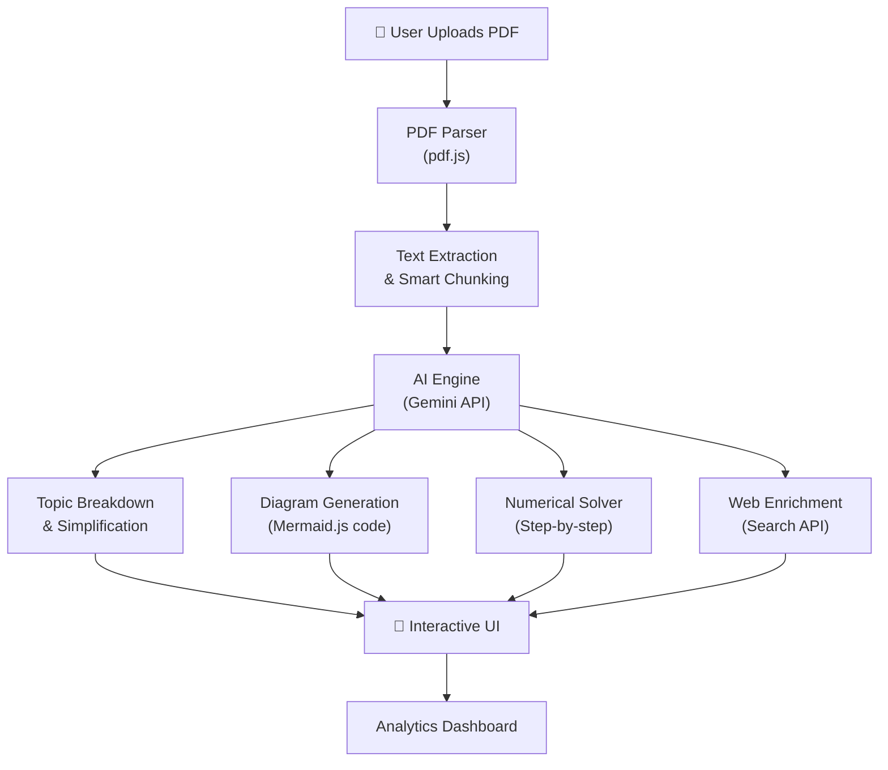

# 📚 PDF Decoder — Study Companion App

> An AI-powered web app that takes any PDF, breaks it down into digestible study material with explanatory diagrams, simplified explanations, step-by-step numerical solving, and supplementary web info.

---

## 🎯 What Problem Does This Solve?

You upload a 6-page or 100+ page PDF (textbook chapters, notes, papers), and instead of losing focus reading dense text, the app:
- **Breaks it into topics** automatically
- **Explains each topic simply** (like a tutor talking to you)
- **Draws diagrams** that actually help you *understand* (process flows, cause-effect chains, comparison tables, step-by-step breakdowns)
- **Solves numericals step-by-step** with visual walkthroughs
- **Pulls extra info from the web** to fill gaps
- **Shows how much content was condensed** (e.g., "100 pages → 12 key topics")

---

## 🧩 Core Features

### 1. 📄 PDF Upload & Parsing
| Detail | Description |
|--------|-------------|
| **Input** | Drag & drop or click to upload any PDF (1–500+ pages) |
| **Parsing** | Extracts text, tables, equations, and images from the PDF |
| **Smart Chunking** | Splits content into logical topics/sections (not just by page) |
| **Page Stats** | Shows original page count, detected topics, and compression ratio |

### 2. 🧠 AI-Powered Topic Breakdown
| Detail | Description |
|--------|-------------|
| **Topic Detection** | Identifies distinct topics/concepts from the PDF |
| **Simple Explanations** | Rewrites each topic in plain, easy-to-understand language |
| **Key Takeaways** | Bullet-point summary of what you need to remember |
| **Difficulty Tagging** | Labels topics as Easy / Medium / Hard |
| **Estimated Read Time** | How long each simplified section takes to read |

### 3. 📊 Explanatory Diagrams (The Core Feature)

> [!IMPORTANT]
> These are NOT generic mind maps. These are **topic-specific, explanatory diagrams** that help you actually *understand* the material.

| Diagram Type | When It's Used | Example |
|--------------|----------------|---------|
| **Process Flowcharts** | Sequential processes, algorithms, procedures | "How does DNA replication work?" — step-by-step flow |
| **Cause-Effect Chains** | Understanding why things happen | "What causes inflation?" — chain diagram |
| **Comparison Tables** | Comparing 2+ concepts | "TCP vs UDP" — side-by-side visual |
| **Concept Relationship Diagrams** | How ideas connect to each other | "Newton's Laws" — how they relate |
| **Step-by-Step Problem Solving** | Numericals & calculations | "Solve this integral" — each step visualized |
| **Timeline / Sequence Diagrams** | Historical events, processes in order | "History of computing" — timeline |
| **Hierarchy / Tree Diagrams** | Classification, taxonomy | "Types of chemical bonds" — tree |
| **Annotated Illustrations** | Visual explanations with labels | Circuit diagrams, anatomy, etc. |

All diagrams are generated using **Mermaid.js** (for flowcharts, sequences, trees) and **Canvas/SVG** (for custom illustrations).

### 4. 🔢 Numerical / Problem Solver
| Detail | Description |
|--------|-------------|
| **Detection** | Auto-detects numerical problems in the PDF |
| **Step-by-Step Solution** | Shows every step with explanations |
| **Formula Highlighting** | Highlights which formula is used and why |
| **Visual Walkthrough** | Diagram showing the solution process |
| **Similar Problems** | Generates practice problems on the same concept |

### 5. 🌐 Web Enrichment
| Detail | Description |
|--------|-------------|
| **Smart Search** | For each topic, fetches 2-3 relevant web snippets |
| **Source Citations** | Shows where the extra info came from |
| **Gap Filling** | If the PDF explanation is incomplete, web info fills the gaps |
| **Efficiency** | Only fetches when needed — keeps it lean, not overwhelming |

### 6. 📉 Content Analytics Dashboard
| Metric | Description |
|--------|-------------|
| **Original Pages** | How many pages the PDF has |
| **Topics Found** | Number of distinct topics detected |
| **Compression Ratio** | e.g., "100 pages → 15 key topics (85% reduction)" |
| **Diagrams Generated** | Count of visual aids created |
| **Study Time Estimate** | Estimated time to go through simplified content |

---

## 🏗️ Technical Architecture



### Tech Stack

| Layer | Technology | Why |
|-------|-----------|-----|
| **Frontend** | HTML + CSS + Vanilla JS | Simple, fast, no build tools needed for studying |
| **PDF Parsing** | [pdf.js](https://mozilla.github.io/pdf.js/) (Mozilla) | Best open-source PDF parser, runs in-browser |
| **AI/LLM** | Google Gemini API | Free tier, great at explanations, can generate diagram code |
| **Diagrams** | Mermaid.js | Renders flowcharts, sequence diagrams, etc. from text |
| **Math Rendering** | KaTeX | Fast LaTeX math rendering for equations |
| **Web Search** | Google Custom Search API / DuckDuckGo | For supplementary info |
| **Styling** | Custom CSS with dark mode | Premium study-friendly UI |

> [!NOTE]
> **No backend server needed!** Everything runs in the browser. The only external calls are to the Gemini API and optionally a search API. Your PDF data stays on your machine.

---

## 🖥️ UI / UX Design

### Layout
```
┌─────────────────────────────────────────────────────┐
│  🧠 PDF Decoder — Study Companion          [🌙/☀️] │
├──────────────┬──────────────────────────────────────┤
│              │                                      │
│  📄 PDF      │   📖 STUDY VIEW                     │
│  Navigator   │                                      │
│              │   Topic 1: [Title]                   │
│  Topics:     │   ────────────────                   │
│  • Topic 1   │   📝 Simple Explanation              │
│  • Topic 2   │   ...text...                         │
│  • Topic 3   │                                      │
│  • Topic 4   │   📊 Diagram                         │
│  ...         │   ┌─────────────────┐                │
│              │   │  [Mermaid/SVG]  │                │
│  ──────────  │   └─────────────────┘                │
│  📊 Stats    │                                      │
│  Pages: 100  │   🔢 Numerical Walkthrough           │
│  Topics: 15  │   Step 1: ...                        │
│  Reduced: 85%│   Step 2: ...                        │
│              │                                      │
│              │   🌐 Extra from Web                  │
│              │   "According to Khan Academy..."     │
│              │                                      │
├──────────────┴──────────────────────────────────────┤
│  ⬅️ Previous Topic    [Progress: 3/15]   Next ➡️    │
└─────────────────────────────────────────────────────┘
```

### Key UI Features
- **Dark mode by default** (easy on eyes during late-night study)
- **Topic-by-topic navigation** (left sidebar)
- **Smooth animations** when switching topics
- **Progress tracking** (which topics you've covered)
- **Responsive design** (works on laptop, tablet, phone)
- **Print/Export** simplified notes as PDF

---

## ⚙️ What You'll Need

| Requirement | Details |
|-------------|---------|
| **Gemini API Key** | Free at [aistudio.google.com](https://aistudio.google.com) — generous free tier |
| **Browser** | Any modern browser (Chrome, Edge, Firefox) |
| **Internet** | For AI calls and web enrichment |
| **Storage** | All processing is client-side; nothing stored on servers |

> [!TIP]
> The Gemini API free tier gives you **1,500 requests/day** — more than enough for studying multiple PDFs daily.

---

## 📋 Build Phases

### Phase 1: Core Foundation
- [ ] Project setup (HTML/CSS/JS structure)
- [ ] PDF upload & parsing with pdf.js
- [ ] Text extraction and display
- [ ] Dark mode UI with sidebar layout

### Phase 2: AI Integration
- [ ] Gemini API integration (API key input)
- [ ] Topic detection & chunking
- [ ] Simple explanations generation
- [ ] Content analytics (page count, compression ratio)

### Phase 3: Diagrams & Visuals
- [ ] Mermaid.js integration
- [ ] AI-generated diagram code for each topic
- [ ] Diagram rendering and display
- [ ] Multiple diagram types support

### Phase 4: Numerical Solver
- [ ] Problem detection in PDF text
- [ ] Step-by-step solution generation
- [ ] KaTeX math rendering
- [ ] Visual solution walkthroughs

### Phase 5: Web Enrichment
- [ ] Search API integration
- [ ] Smart query generation per topic
- [ ] Snippet extraction and display
- [ ] Source citation

### Phase 6: Polish
- [ ] Responsive design
- [ ] Animations and transitions
- [ ] Export/print functionality
- [ ] Loading states and error handling
- [ ] Progress tracking

---

## 🚀 What You'll Get

A single-page web app that you can open in your browser, upload any PDF, and get:

1. **A sidebar** listing all detected topics
2. **For each topic**: a simple explanation, a relevant diagram, key takeaways
3. **For numericals**: step-by-step visual solutions
4. **A stats panel**: showing how much content was condensed
5. **Web snippets**: extra context pulled from the internet (lean and relevant)

All of this with a **premium, dark-mode study UI** that makes studying feel less painful. 🎓

---

> [!CAUTION]
> **Decide before we build:**
> 1. Do you have a Gemini API key, or should I build with a "paste your API key" input?
> 2. Any specific subjects you'll use this for? (helps me optimize the prompt engineering)
> 3. Anything you want to add, remove, or change from this plan?
